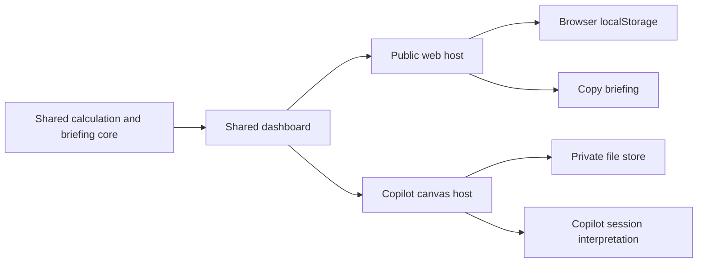

# AI Capacity Compass

AI Capacity Compass is a model-agnostic inference capacity planner for TPM/RPM demand, utilization, bottlenecks, and scenario comparisons. The public web app and Copilot canvas are two small hosts around the same calculation engine and dashboard.

> Presets are illustrative examples, not measured workloads or provider quotas. Every quota and model-specific RPM/TPM ratio is supplied by the user and is unverified.

## Architecture



The deterministic engine, validation, presets, field documentation, briefing facts, guardrails, and UI live in `src/core` and `src/ui`. Host-specific storage and interpretation behavior lives in `src/hosts`. There is one formula implementation: the model receives calculated facts and guardrails, and is instructed not to perform numeric calculations.

## Run locally

Requires Node.js 24 or newer. The project has no npm dependencies.

```sh
npm test
npm run serve
```

`npm run serve` builds `dist/web` and serves it at `http://127.0.0.1:4173`. Scenario data on the web app stays in that browser's local storage. The service worker caches the app's same-origin assets for offline use after the first load. The app makes no analytics, telemetry, backend, or AI API calls; the AI briefing action copies calculated facts and guardrails to the clipboard.

## Copilot canvas extension

Build a self-contained extension directory at `dist/extension/ai-capacity-compass`:

```sh
npm run build:extension
```

The `extension.mjs` entry uses `@github/copilot-sdk/extension`, supplied by Copilot and intentionally not an npm dependency. The install script copies the built files to `$COPILOT_HOME/extensions/ai-capacity-compass` (default `~/.copilot/extensions/ai-capacity-compass`) and leaves any existing `artifacts/` directory untouched:

```sh
npm run install:extension
```

Restart or reload Copilot after installing. To update the canvas, pull the latest repository revision and run `npm run install:extension` again. The canvas keeps scenarios in its private file-backed store; do not commit or share the `artifacts/` directory.

## Keeping both hosts in sync

Each commit is the single source of truth. A push to `main` deploys the public website through GitHub Pages and CI builds an extension ZIP artifact. Both hosts display the package version and short commit SHA used at build time. The website updates on deployment; an already-installed canvas does not update itself and must be reinstalled using the script above (or the matching extension ZIP).

The web app is published at [ai-capacity-compass.quintelier.dev](https://ai-capacity-compass.quintelier.dev) once DNS and the Pages certificate are ready. The default Pages URL is `https://sujithq.github.io/ai-capacity-compas/`.

### DNS and HTTPS

At the DNS provider for `quintelier.dev`, create a CNAME record:

| Type | Name | Target |
| --- | --- | --- |
| CNAME | `ai-capacity-compass` | `sujithq.github.io` |

Verify `quintelier.dev` at the GitHub account level before relying on the custom domain. After DNS resolves and GitHub provisions the certificate, enable **Enforce HTTPS** in the repository's Pages settings.

## Scenario JSON

Web import/export uses a versioned JSON envelope compatible with the scenario data used by the canvas:

```json
{
  "format": "ai-capacity-compass/scenarios",
  "version": 1,
  "activeId": "ex-interactive-chatbot",
  "compareIds": ["ex-interactive-chatbot"],
  "scenarios": [
    {
      "id": "ex-interactive-chatbot",
      "name": "Interactive chatbot",
      "isExample": true,
      "presetId": "interactive-chatbot",
      "notes": "Illustrative example",
      "workload": {
        "concurrentUsers": 100,
        "requestsPerUserPerMinute": 1,
        "avgInputTokens": 1000,
        "avgOutputTokens": 300,
        "rateLimitTokensPerRequest": null,
        "peakMultiplier": 1,
        "growthMultiplier": 1,
        "targetUtilizationPct": 80,
        "avgLatencySeconds": null
      },
      "deployment": {
        "provider": "",
        "modelName": "",
        "deploymentType": "",
        "allocatedTPM": null,
        "allocatedRPM": null,
        "rpmPer1000TPM": null,
        "tpmOverride": null,
        "rpmOverride": null
      },
      "interpretation": null,
      "updatedAt": "2026-01-01T00:00:00.000Z"
    }
  ]
}
```

Imports accept only this format/version, validate every scenario's fields and values, discard unknown properties and old interpretations, and reject malformed or oversized files. Import replaces the scenarios saved in the current browser after confirmation; export a backup first if needed. The canvas stores its scenarios separately and does not send them to the website.

## Documentation references

The dashboard links to Microsoft Learn references for [throughput and latency](https://learn.microsoft.com/en-us/azure/foundry/openai/how-to/latency), [token and request metrics](https://learn.microsoft.com/en-us/azure/foundry/openai/monitor-openai-reference), [quota allocation](https://learn.microsoft.com/en-us/azure/foundry/openai/how-to/quota), [quota tiers and limits](https://learn.microsoft.com/en-us/azure/foundry/openai/quotas-limits), [deployment types](https://learn.microsoft.com/en-us/azure/foundry/foundry-models/concepts/deployment-types), and [provisioned throughput sizing](https://learn.microsoft.com/en-us/azure/foundry/openai/how-to/provisioned-throughput-sizing). These are references only; no quota information is fetched or verified.

## License

No license has been selected yet, so this repository intentionally does not include a `LICENSE` file.
