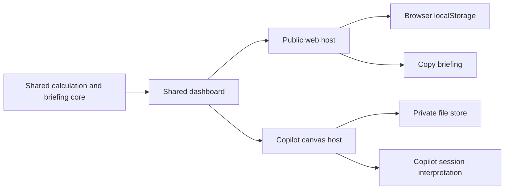

# AI Capacity Compass

AI Capacity Compass is an inference capacity planner for request/token quotas and Azure-style provisioned throughput (PTU) sizing. The public web app and Copilot canvas share the same calculation engine and dashboard.

> Presets are illustrative examples, not measured workloads or provider quotas. Every quota and model-specific RPM/TPM ratio is supplied by the user and is unverified.

## Provisioned throughput sizing

In **Deployment → Capacity model**, choose **Provisioned (PTU)**. Quota (TPM/RPM) remains the default. Enter the deployed PTUs, input TPM per PTU, output-to-input token ratio, prompt cache rate, minimum PTUs, and scale increment for your model/version and deployment type. No model-specific values are built in or verified. The **Provisioned assistant (PTU)** example uses fictional values.

At peak demand, the planner discounts cached input TPM and adds output TPM weighted by the supplied ratio. It divides that normalized TPM by input TPM per PTU, then rounds up to a multiple of the scale increment at or above the minimum. The headroom estimate divides the raw requirement by the target utilization before rounding. Leave deployed PTUs blank to size a new deployment; utilization, shortfall/surplus, and RPM ceilings require a deployed or planned allocation.

The RPM ceiling assumes the same request mix. Actual throughput requires benchmarking; utilization above 100% typically causes HTTP 429 responses, and spillover to standard deployments is not modeled. Quota and PTU scenarios share peak RPM and theoretical RPM columns, but their utilization and sizing metrics are shown separately.

**GPT-6 and newer:** The simple ratio model does not account for the newer normalized-token method's cached-input weights, cache writes, or context-specific weights. An externally calculated effective ratio can give an approximation for a specific mix, not a faithful model. See Microsoft Learn's [PTU sizing guide](https://learn.microsoft.com/en-us/azure/foundry/openai/how-to/provisioned-throughput-sizing), [provisioned throughput concepts](https://learn.microsoft.com/en-us/azure/foundry/openai/concepts/provisioned-throughput), and [deployment types](https://learn.microsoft.com/en-us/azure/foundry/foundry-models/concepts/deployment-types).

## Architecture

### Microsoft Learn reference catalogue

In the Deployment panel, choose a **Microsoft Learn reference**, then select **Use selected reference**. The selection sets the provider and model, and the version and deployment type when the record specifies them. References supply sizing defaults only for blank inputs; manual sizing inputs are never replaced. Editing the identity so it no longer matches the selected reference stops it from applying. Select **Manual inputs / no reference** and **Clear reference** to disable it.

The bundled Azure OpenAI snapshot (`2026-11-19.2`, verified November 19, 2026) covers 18 versioned text models across Global, Data Zone, and Regional Provisioned. GPT-6+ and GPT-image variants use different sizing methods and produce no PTU estimate. Quota matching prefers a version-specific documented ratio, then a documented model-level capacity unit, then a ratio **Derived from published tier limits** for the selected deployment type. The unit table does not specify versions or deployment types; tier-derived ratios do not specify versions. Ratios can differ by version: for Global Standard `gpt-chat-latest`, Microsoft documents 10 RPM per 1,000 TPM for the May/June 2026 versions and 1 for the August/October versions.

Sources: [PTU parameters](https://learn.microsoft.com/en-us/azure/foundry/openai/how-to/provisioned-throughput-sizing), [quota guide capacity units](https://learn.microsoft.com/en-us/azure/foundry/openai/how-to/quota#understanding-rate-limits), and [quota tiers and version-specific ratios](https://learn.microsoft.com/en-us/azure/foundry/openai/quotas-limits#quota-tier-reference). Tier-derived ratios use `RPM ÷ TPM × 1,000` and are included only when every published tier for the model and Standard deployment type agrees. Rows using per-10-second request counts, missing TPM, or non-text-token limits are excluded; embeddings are included only where both per-minute limits are published. The offline catalogue neither verifies availability nor sets assigned TPM/RPM or deployed PTUs. With user-entered TPM and blank RPM, a reference or manual ratio yields a **derived RPM estimate**; explicit RPM and overrides win. Recheck Learn and your actual allocation in Foundry.

### Shared hosts



The deterministic engine, validation, presets, field documentation, briefing facts, guardrails, and UI live in `src/core` and `src/ui`. Host-specific storage and interpretation behavior lives in `src/hosts`. There is one formula implementation: the model receives calculated facts and guardrails, and is instructed not to perform numeric calculations.

## Run locally

Requires Node.js 24 or newer. CI and deployment use the latest Node.js LTS release (currently 26). The project has no npm dependencies.

```sh
npm test
npm run serve
```

`npm run serve` builds `dist/web` and serves its `index.html` at `http://127.0.0.1:4173`, just as GitHub Pages serves the deployed build. The web app follows the system light/dark preference by default; its accessible theme toggle remembers an explicit choice in browser storage. The Visual style selector offers Classic (the default) and Fluent, and remembers an explicit choice separately. Fluent uses Microsoft Fluent-inspired typography, blue accents, surfaces, and controls; it is an independent visual option, not an affiliation claim. Both styles work with light and dark themes. The canvas inherits Copilot's theme and has no separate theme or style selector. Only the web build adds a Content Security Policy; the canvas can still receive Copilot's theme styles. Scenario data on the web app stays in that browser's local storage. Online visits check the network for current assets; after the service worker installs, the versioned app cache provides an offline fallback. The app makes no analytics, telemetry, backend, or AI API calls; the AI briefing action copies calculated facts and guardrails to the clipboard, or you can copy them manually from the preview.

## Copilot canvas extension

Build a self-contained extension directory at `dist/extension/ai-capacity-compass`:

```sh
npm run build:extension
```

The `extension.mjs` entry uses `@github/copilot-sdk/extension`, supplied by Copilot and intentionally not an npm dependency. The install script copies the built files to `$COPILOT_HOME/extensions/ai-capacity-compass` (default `~/.copilot/extensions/ai-capacity-compass`) and leaves any existing `artifacts/` directory untouched:

```sh
npm run install:extension
```

Restart or reload Copilot after installing. To update the canvas, pull the latest repository revision and run `npm run install:extension` again. The canvas keeps scenarios in its private file-backed store; do not commit or share the `artifacts/` directory.

## Keeping both hosts in sync

Each commit is the single source of truth. A push to `main` deploys the public website through GitHub Pages and CI builds an extension ZIP artifact. Both hosts display the package version and short commit SHA used at build time. The website updates on deployment; an already-installed canvas does not update itself and must be reinstalled using the script above (or the matching extension ZIP).

The web app is published at [ai-capacity-compass.quintelier.dev](https://ai-capacity-compass.quintelier.dev) once DNS and the Pages certificate are ready. The default Pages URL is `https://sujithq.github.io/ai-capacity-compas/`.

### DNS and HTTPS

At the DNS provider for `quintelier.dev`, create a CNAME record:

| Type | Name | Target |
| --- | --- | --- |
| CNAME | `ai-capacity-compass` | `sujithq.github.io` |

Verify `quintelier.dev` at the GitHub account level before relying on the custom domain. After DNS resolves and GitHub provisions the certificate, enable **Enforce HTTPS** in the repository's Pages settings.

## Scenario JSON

Web import/export uses a versioned JSON envelope compatible with the scenario data used by the canvas:

```json
{
  "format": "ai-capacity-compass/scenarios",
  "version": 1,
  "activeId": "ex-interactive-chatbot",
  "compareIds": ["ex-interactive-chatbot"],
  "scenarios": [
    {
      "id": "ex-interactive-chatbot",
      "name": "Interactive chatbot",
      "isExample": true,
      "presetId": "interactive-chatbot",
      "notes": "Illustrative example",
      "workload": {
        "concurrentUsers": 100,
        "requestsPerUserPerMinute": 1,
        "avgInputTokens": 1000,
        "avgOutputTokens": 300,
        "rateLimitTokensPerRequest": null,
        "peakMultiplier": 1,
        "growthMultiplier": 1,
        "targetUtilizationPct": 80,
        "avgLatencySeconds": null
      },
      "deployment": {
          "capacityModel": "quota",
        "provider": "",
        "modelName": "",
        "deploymentType": "",
        "allocatedTPM": null,
        "allocatedRPM": null,
        "rpmPer1000TPM": null,
        "tpmOverride": null,
        "rpmOverride": null
      },
      "interpretation": null,
      "updatedAt": "2026-01-01T00:00:00.000Z"
    }
  ]
}
```

Imports accept only this format/version, validate every scenario's fields and values, discard unknown properties and old interpretations, and reject malformed or oversized files. Import replaces the scenarios saved in the current browser after confirmation; export a backup first if needed. The canvas stores its scenarios separately and does not send them to the website.

Version 1 scenarios without `deployment.capacityModel` still load as `quota`. For PTU scenarios set it to `ptu`; the optional numeric fields are `deployedPTUs`, `inputTPMPerPTU`, `outputTokenRatio`, `promptCacheRatePct` (0–100), `minimumPTUs`, and `ptuScaleIncrement`. Use `null` or omit an unknown value. Switching modes preserves the other mode's inputs but ignores them in calculations.

The optional `deployment.modelVersion` and `deployment.referenceId` retain the selected catalogue identity. Export stores the reference ID, not copied coefficients. On import, the reference applies only when it is the best match for the mode and identity fields its source specifies. A later catalogue update can revise reference defaults; manual values remain unchanged.

## Documentation references

The dashboard links to Microsoft Learn references for [throughput and latency](https://learn.microsoft.com/en-us/azure/foundry/openai/how-to/latency), [token and request metrics](https://learn.microsoft.com/en-us/azure/foundry/openai/monitor-openai-reference), [quota allocation](https://learn.microsoft.com/en-us/azure/foundry/openai/how-to/quota), [quota tiers and limits](https://learn.microsoft.com/en-us/azure/foundry/openai/quotas-limits), [deployment types](https://learn.microsoft.com/en-us/azure/foundry/foundry-models/concepts/deployment-types), and [provisioned throughput sizing](https://learn.microsoft.com/en-us/azure/foundry/openai/how-to/provisioned-throughput-sizing). These are references only; no quota information is fetched or verified.

The Fluent-inspired visual option takes design cues from the [Fluent 2 design system](https://fluent2.microsoft.design/); it uses no external fonts, scripts, or runtime resources.

## License

No license has been selected yet, so this repository intentionally does not include a `LICENSE` file.
